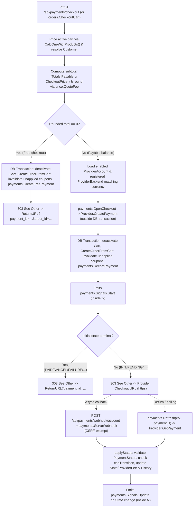

# Payments & Checkout

The `orders` checkout orchestration (`contrib/shop/orders/checkout.go`) and `payments` (`contrib/shop/payments`) packages, together with the public HTTP views (`contrib/shop/views/public/payment_options.go`, `payment_checkout.go`), coordinate code-first PSP registration, currency-aware fee quoting, guest and authenticated checkout, free (zero-total) checkouts, provider redirects, webhook reconciliation, and native `Refund` / `Cancel` operations.

---

## Checkout & Webhook Reconciliation Flow

For the application logic that uses the checkout result and payment signals to start delivery, see the [order decision and payment flow](signals-and-order-flow.md#order-decision-and-payment).



---

## Checkout Orchestration (`contrib/shop/orders/checkout.go`)

`orders.CheckoutCart` prices an active cart, opens checkout with the payment provider **before** mutating the database, and converts the cart into an order and payment record in one transaction only after the provider accepts the checkout request.

### Types & Sentinel Errors

```go
var (
	ErrCheckoutEmpty              = errors.New("checkout cart is empty")
	ErrCustomerRequired           = errors.New("a customer email address is required")
	ErrCheckoutAccountRequired    = errors.New("payment account is required")
	ErrCheckoutAccountUnavailable = errors.New("payment account is unavailable")
	ErrCheckoutConflict           = errors.New("cart changed or already has a checkout")
)

// CheckoutPricer calculates a custom server-side subtotal before the payment
// provider account adds its fee.
type CheckoutPricer func(ctx context.Context, cart *carts.CartRow) (price.Money, error)

func (fn CheckoutPricer) CheckoutSubtotal(ctx context.Context, cart *carts.CartRow) (price.Money, error)

type CheckoutOptions struct {
	Cart        *carts.Cart
	AccountID   drivers.ULID
	Currency    currency.Unit
	GetCurrency func(context.Context) currency.Unit
	ReturnURL   func(paymentID, orderID drivers.ULID) string
	WebhookURL  func(account *payments.ProviderAccount) string
	Pricer      CheckoutPricer
}

type CheckoutResult struct {
	Order    *Order
	Items    []*OrderItem
	Payment  *payments.Payment
	Checkout payments.Checkout
	Free     bool
}
```

### `CheckoutCart`

```go
func CheckoutCart(r *http.Request, opts CheckoutOptions) (*CheckoutResult, error)
```

1. Validates `r != nil` and `queries.IsCommitContext(r.Context())`.
2. Loads and prices the cart via `CalcOneWithProducts()` (either `opts.Cart` by `ID` when supplied, or `carts.Query().WithContext(ctx).CartForRequest(r)`):
   - Returns `ErrCheckoutConflict` if the cart is inactive (`!pricedCart.Object.Active`).
   - Returns `ErrCheckoutEmpty` if `len(pricedCart.Items) == 0`.
3. Resolves the buyer (`resolveCheckoutCustomer`):
   - **Cart customer (guest or authenticated)**: if `cart.Customer` has a non-zero ID, reloads it if `Email` is not populated and requires a non-empty email address (else `ErrCustomerRequired`).
   - **Authenticated user fallback**: if `cart.Customer` is unset and an authenticated `users.User` is on the request, looks up their oldest `customers.Customer` (`OrderBy("FirstSeen", "ID").First()`) or prepares a pending `customers.Customer` from the user's `Email`, `FirstName`, and `LastName` attributes (validated with `mail.ParseAddress`, else `ErrCustomerRequired`).
   - If neither `cart.Customer` nor an authenticated user is present, returns `ErrCustomerRequired`.
4. Resolves the currency (`opts.GetCurrency(ctx)` if non-zero, otherwise `opts.Currency`) and computes `subtotal`:
   - Default: `price.Money{Amount: pricedCart.Totals.Payable(), Currency: unit}`.
   - If `opts.Pricer != nil`, calls `opts.Pricer(ctx, pricedCart)` (defaulting `subtotal.Currency` to `unit` if zero).
   - Rejects negative amounts with `payments.ErrNonPositiveTotal`.
   - Computes currency-rounded zero-fee quote via `price.QuoteFee(subtotal, decimal.Zero, decimal.Zero)`.
5. Allocates a fresh `paymentID := drivers.NewULID()`:
   - **Free checkout (`zeroQuote.Total.IsZero()`)**: skips provider calls and immediately runs `finalizeCheckout` with `payments.CreateFreePayment(txCtx, order, subtotal.Currency, paymentID)` and `Free: true`.
   - **Paid checkout**:
     - Enforces `!queries.IsTransactionContext(ctx)` so the provider HTTP call never holds an open DB transaction.
     - Loads `opts.AccountID` (`ErrCheckoutAccountRequired` if zero) from `payments.ProviderAccount` (`Enabled == true`), verifies its `InternalName` is registered via `payments.RetrieveProvider`, and verifies `backend.Currency(ctx) == subtotal.Currency` (else `ErrCheckoutAccountUnavailable`).
     - Builds `returnURL` (`opts.ReturnURL(paymentID, drivers.ULID{})`) and `webhookURL` (`opts.WebhookURL(account)`).
     - Calls `payments.OpenCheckout(ctx, account, paymentID, subtotal, returnURL, webhookURL)` (no DB writes yet).
     - Runs `finalizeCheckout` with `payments.RecordPayment(txCtx, order, account, paymentID, quote, checkout)` and `Free: false`.
6. Inside `finalizeCheckout` (single database transaction):
   - Creates the pending `customers.Customer` if needed.
   - Marks the active cart `Active = false` (also binding `Customer` and `User` if previously unset) with optimistic filter `(ID, Active = true)` (`ErrCheckoutConflict` if `count != 1`).
   - Calls `CreateOrderFromCart(r.WithContext(txCtx), customer, pricedCart)` (mapping `ErrCartRedemptionsChanged` to `ErrCheckoutConflict`).
   - Invalidates any remaining unattached `coupons.Redemption` rows on that cart (`Order__isnull = true`, `Invalidated = false` -> `Invalidated = true`).
   - Persists the `Payment` (`CreateFreePayment` or `RecordPayment`, where `RecordPayment` emits `payments.Signals.Start`).
   - Commits and returns `*CheckoutResult`.

---

## Predefined Checkout Flow (`views/public/`)

### 1. Quote Options (`GET /api/payments/options`)

Handled by `public.PaymentsAPI.PaymentOptions` (`contrib/shop/views/public/payment_options.go`):
- Resolves currency via `PaymentsAPI.GetCurrency(ctx)` falling back to `PaymentsAPI.Currency` (`503` if zero `currency.Unit`).
- Calculates the caller's active cart via `cartQuery(ctx, r, false).CalcOne()` (`404` if no cart).
- Computes `subtotal := price.Money{Amount: cart.Totals.Payable(), Currency: unit}` and a zero-fee `price.QuoteFee(subtotal, 0, 0)`.
- **Free checkout check**: if `len(cart.Items) > 0` and `quote.Total.IsZero()`, returns a single `PaymentOption`:
  ```go
  PaymentOption{
      Label:             trans.T(ctx, "No payment required"),
      NoPaymentRequired: true,
      Quote:             quote,
  }
  ```
- Otherwise queries `ProviderAccount` rows with `Enabled == true`, resolves each account's registered `ProviderBackend` via `payments.RetrieveProvider(account.InternalName)`, filters to backends whose `Currency(ctx) == unit`, quotes via `account.Quote(ctx, subtotal)`, sorts by `(backend.Ordering(), backend.Label(ctx), account.ID)`, and returns `[]PaymentOption` wrapped in `api.DataResponse`.

### 2. Start Checkout (`POST /api/payments/checkout`)

Handled by `public.CheckoutAPI.Checkout` (`contrib/shop/views/public/payment_checkout.go`):
- Sets `Cache-Control: no-store`. Enforces `POST` (`405`) and decodes `PaymentCheckoutRequest{ AccountID string `json:"account_id"` }` from `application/json` (strict, single object, `DisallowUnknownFields`, max 8 KiB) or `application/x-www-form-urlencoded`.
- Works for both **guest shoppers** (with customer details attached to the cart via `POST /api/carts/customer`) and **authenticated users**.
- Validates resolved `currency.Unit`, `CheckoutAPI.Origin` (`http`/`https`, no userinfo/query/fragment/non-root path), and `CheckoutAPI.ReturnPath` (relative path starting with `/`, not `//`, defaulting to `"/"`).
- Verifies `!queries.IsTransactionContext(r.Context()) && queries.IsCommitContext(r.Context())` (`500` otherwise).
- Calls `orders.CheckoutCart(r, orders.CheckoutOptions{...})` with `ReturnURL` appending `payment_id` (and `order_id` for free checkouts) and `WebhookURL` resolving `django.Reverse("api:payments:webhook", account.ID)`.
- Redirects (`303 See Other`):
  - **Free checkout (`result.Free`)**: redirects to `returnURL` with `payment_id` and `order_id`.
  - **Paid checkout with immediate terminal state** (`PAID`, `CANCEL`, `EXPIRED`, `DENIED`, `FAILURE`, `REFUND`, `PARTIAL_REFUND`, `CHARGEBACK`): redirects to `returnURL` with `payment_id`.
  - **Paid checkout with redirect URL**: validates `result.Checkout.URL` (`https`, non-empty host, no userinfo; else `502`) and redirects to `result.Checkout.URL`.

### 3. Provider Webhooks (`POST /api/payments/webhook/<<account>>`)

Calls `payments.ServeWebhook(w, r, accountID)` (exempt from `nosurf` CSRF middleware).

---

## Code-First Provider Backend Registry & Sync

Provider configuration, fees, currency, and credentials live in Go code (`contrib/shop/payments/provider*.go`), never in the database. The `ProviderAccount` database table only tracks `(ID, InternalName, Enabled)`.

### `ProviderBackend` (`provider_backend.go`)

```go
type ProviderBackend interface {
	Ordering() int // lowest first, defaults to InternalName otherwise
	InternalName() string
	Label(ctx context.Context) string
	Currency(ctx context.Context) currency.Unit
	FixedFee(ctx context.Context) decimal.Decimal
	PercentageFee(ctx context.Context) decimal.Decimal
	Provider(ctx context.Context, account *ProviderAccount) (Provider, error)
}
```

### `PSP` Declarative Struct (`provider.go`)

`payments.PSP` is a ready-to-use `ProviderBackend` implementation:

```go
type PSP struct {
	Order             int
	Name              string
	TextLabel         func(ctx context.Context) string
	CurrencyUnit      currency.Unit
	GetCurrency       func(ctx context.Context) currency.Unit
	FixedFeeAmount    decimal.Decimal
	GetFixedFee       func(ctx context.Context) decimal.Decimal
	PercentageFeeRate decimal.Decimal
	GetPercentageFee  func(ctx context.Context) decimal.Decimal
	Factory           ProviderFactory
}
```

- `Label(ctx)` falls back to `attrs.NiceName(p.Name)` when `TextLabel == nil`.
- `Currency(ctx)`, `FixedFee(ctx)`, and `PercentageFee(ctx)` prefer `GetCurrency`/`GetFixedFee`/`GetPercentageFee` when non-nil, falling back to `CurrencyUnit`/`FixedFeeAmount`/`PercentageFeeRate`.
- `Provider(ctx, account)` invokes `Factory(ctx, account)` (returning an error if `Factory == nil`).

### `BoundProviderBackend` & Registry Functions (`provider_backend.go`, `provider_registry.go`)

The global registry is thread-safe (`sync.RWMutex` + `orderedmap.OrderedMap[string, ProviderBackend]`):

| Function | Signature | Behavior |
| :--- | :--- | :--- |
| `RegisterProvider` | `RegisterProvider(b ProviderBackend)` | Registers (or replaces) `b` keyed by `b.InternalName()`. Panics if `b == nil`, name is blank, or name is reserved `"shop:free-checkout"`. |
| `RetrieveProvider` | `RetrieveProvider[S ~string](name S) (ProviderBackend, bool)` | Looks up a registered backend by `InternalName`. |
| `ProviderRegistered` | `ProviderRegistered[S ~string](name S) bool` | Reports whether a backend with `name` is registered. |
| `ProviderBackendCount` | `ProviderBackendCount() int` | Returns the number of registered backends. |
| `IterProviderBackends` | `IterProviderBackends(useOrdering bool) iter.Seq2[int, ProviderBackend]` | Iterates over backends (sorted stably by `Ordering()` then `InternalName()` when `useOrdering == true`, or registration order when `false`). |
| `BoundProviderBackends` | `BoundProviderBackends(ctx context.Context) []BoundProviderBackend` | Returns all backends wrapped with `ctx` in display order (`Label()`, `Currency()`, `FixedFee()`, `PercentageFee()`, `Quote(subtotal)`). |

### `ProvidersQuery().Sync()` & `sync-psp` (`provider_query.go`, `command_sync_psp.go`)

`payments.ProvidersQuery()` wraps `*queries.QuerySet[*ProviderAccount]`. Calling `Sync()` (or running the `sync-psp` CLI command):
1. Collects all `InternalName()` values from `IterProviderBackends(false)`.
2. Disables (`Enabled = false`) any `ProviderAccount` row not in the registered list (or all rows if none are registered).
3. Preserves `Enabled` on existing registered rows (manual disables are kept).
4. Bulk-creates `&ProviderAccount{InternalName: name, Enabled: true}` for any newly registered backend.

---

## `payments` Service Functions (`contrib/shop/payments/service.go`)

### Sentinel Errors

```go
var (
	ErrInvalidWebhook       = errors.New("invalid payment webhook")
	ErrUnsupportedOperation = errors.New("payment provider does not support operation")
	ErrNonPositiveTotal     = errors.New("payment total must be positive")
)
```

### Checkout & Payment Creation

- `OpenCheckout(ctx, account *ProviderAccount, attemptID drivers.ULID, subtotal price.Money, returnURL, webhookURL string) (price.Quote, Checkout, error)`:
  - Validates non-zero `attemptID`, non-nil enabled `account`, computes `quote, err := account.Quote(ctx, subtotal)` (rejecting `!quote.Total.IsPositive()` with `ErrNonPositiveTotal`), resolves the `Provider`, calls `provider.CreatePayment`, and validates the returned `PaymentStatus` (known state, non-empty `ProviderRef`, matching `Amount`/`Currency`, non-negative `ProviderFee` with valid currency unit if set).
  - Performs **no database writes**.
- `RecordPayment(ctx, order attrs.Definer, account *ProviderAccount, id drivers.ULID, quote price.Quote, checkout Checkout) (*Payment, error)`:
  - Validates `order`, `account`, `id`, `quote`, and `checkout.PaymentStatus`.
  - Inside a transaction, inserts `&Payment{...}` with `Provider: account.InternalName`, `TransactionID: checkout.ProviderRef`, `CheckoutURL`, `State`, `Amount: quote.Total`, `Fee: quote.Fee`, `RefundedAmount: 0`, `ProviderFee`, `Currency: quote.Currency.String()`, and initial `EventCheckoutOpened` in `History`.
  - Emits `payments.Signals.Start` (`PaymentStartedSignal`) inside the transaction before committing.
- `CreateFreePayment(ctx, order attrs.Definer, unit currency.Unit, id drivers.ULID) (*Payment, error)`:
  - Records a zero-total order with `Provider: "shop:free-checkout"`, `State: paystate.STATUS_NO_PAYMENT_REQUIRED`, `Amount: 0`, `Fee: 0`, `RefundedAmount: 0`, `Currency: unit.String()`, and `EventNoPaymentRequired` in `History` (`Payment.IsFreeCheckout() == true`).

### Refresh & Webhooks

- `Refresh(ctx, id drivers.ULID) (*Payment, error)`:
  - Loads the attempt (even if the account is disabled). Returns `(payment, nil)` unchanged for free checkouts or attempts without `TransactionID.Valid`.
  - Calls `provider.GetPayment(ctx, payment.TransactionID.String)` and applies the result via `applyStatus`:
    - Validates `PaymentStatus` against `payment.Amount`, `payment.CurrencyUnit()`, and `payment.TransactionID`.
    - Updates `State` and/or `ProviderFee`, appending `EventStatusUpdated` or `EventProviderFeeUpdated`.
    - Ignores disallowed state transitions (returning `(payment, nil)`).
    - Updates optimistically filtered by `(ID, State == prior)` and fires `payments.Signals.Update` inside the transaction when `State` changed (not for `ProviderFee`-only updates).
- `ServeWebhook(w, request, accountID)`:
  - Parses `accountID` as ULID (`404`), loads `ProviderAccount` even if disabled (`404` if missing, `503` on DB/provider error), reads up to `1 MiB` of body (`400`), calls `provider.HandleWebhook` (`400` on `ErrInvalidWebhook`), verifies `payment.Provider == account.InternalName`, reconciles the `Payment` matching `(Account, TransactionID)` via `applyStatus` (`503` on error), and invokes `result.Acknowledge(w)` or writes `200 OK`.

### Post-Payment Operations (`Refund`, `Cancel`)

Both operations enforce `queries.IsCommitContext(ctx)`, `!queries.IsTransactionContext(ctx)`, non-empty `requestID` (`<= 128` bytes), non-free payment (`ErrUnsupportedOperation`), and a non-empty `TransactionID`:

- `Refund(ctx, id drivers.ULID, requestID string, amount decimal.Decimal) (RefundResult, error)`:
  - Requires provider to implement `Refunder` (else `ErrUnsupportedOperation`).
  - **Idempotent replay**: scans `payment.History.Data` for `event.RequestID == requestID` — returns stored `RefundResult{ProviderRef: event.ProviderRef}` if `EventRefunded` with equal `amount`, or errors if reused with a different payload.
  - Requires `payment.State` in `STATUS_PAID` or `STATUS_PARTIAL_REFUND`, positive `amount` within the currency's ISO precision scale, and `payment.RefundedAmount + amount <= payment.Amount`.
  - Calls `refunder.RefundPayment(ctx, RefundRequest{ProviderRef, RequestID, Amount})` outside a transaction.
  - Opens a transaction, updates `RefundedAmount`, transitions `State` to `STATUS_PARTIAL_REFUND` or `STATUS_REFUND` (when `newRefunded == payment.Amount`), appends `EventRefunded`, updates optimistically filtered by `(ID, State == priorState, RefundedAmount == priorRefunded)`, emits `Signals.Refund` and (if state changed) `Signals.Update`, and commits.
- `Cancel(ctx, id drivers.ULID, requestID string) error`:
  - Requires provider to implement `Canceller` (else `ErrUnsupportedOperation`).
  - **Idempotent replay**: returns `nil` if `History` already has `EventCancelled` with `requestID`, or errors if reused for a different event.
  - Requires `payment.State` in `STATUS_INIT`, `STATUS_PENDING`, or `STATUS_VERIFY`.
  - Calls `canceller.CancelPayment(ctx, CancelRequest{ProviderRef, RequestID})` outside a transaction.
  - Opens a transaction, sets `State = STATUS_CANCEL`, appends `EventCancelled`, updates optimistically filtered by `(ID, State == priorState)`, emits `Signals.Cancel` and `Signals.Update`, and commits.

### `canTransition(from, to paystate.PayState) bool`

State transitions enforced by `applyStatus`:
- Never transitions into `STATUS_NO_PAYMENT_REQUIRED`.
- From `STATUS_INIT`: any other valid state.
- From `STATUS_PENDING`: any state except `STATUS_INIT`.
- From `STATUS_VERIFY`, `STATUS_PARTIAL_PAYMENT`, `STATUS_AUTHORIZE`: any state except `STATUS_INIT` and `STATUS_PENDING`.
- From `STATUS_PARTLY_CAPTURED`: `STATUS_PAID` or `STATUS_VERIFY`.
- From `STATUS_PAID`, `STATUS_REFUNDING`, `STATUS_PARTIAL_REFUND`: `STATUS_REFUNDING`, `STATUS_PARTIAL_REFUND`, `STATUS_REFUND`, or `STATUS_CHARGEBACK`.
- All other states: terminal (`false`).

---

## Provider & Capability Interfaces (`contrib/shop/payments/payments.go`)

### Core & Optional Capability Interfaces

| Interface | Methods |
| :--- | :--- |
| `Provider` | `CreatePayment(context.Context, CreatePaymentRequest) (Checkout, error)`<br>`GetPayment(context.Context, string) (PaymentStatus, error)`<br>`HandleWebhook(context.Context, WebhookRequest) (WebhookResult, error)` |
| `Refunder` | `RefundPayment(context.Context, RefundRequest) (RefundResult, error)` |
| `Canceller` | `CancelPayment(context.Context, CancelRequest) error` |

- `type ProviderFactory func(context.Context, *ProviderAccount) (Provider, error)`

### Request, Result & Status Types

- `CreatePaymentRequest`: `AttemptID drivers.ULID`, `Amount price.Money`, `ReturnURL string`, `WebhookURL string`
- `PaymentStatus`: `ProviderRef string`, `State paystate.PayState`, `Amount price.Money`, `ProviderFee *price.Money`
- `Checkout`: embeds `PaymentStatus`, plus `URL string`
- `WebhookRequest`: `Method string`, `Header http.Header`, `URL *url.URL`, `Body []byte`
- `WebhookResult`: `Payment PaymentStatus`, `Acknowledge func(http.ResponseWriter)`
- `RefundRequest`: `ProviderRef string`, `RequestID string`, `Amount price.Money`
- `RefundResult`: `ProviderRef string`
- `CancelRequest`: `ProviderRef string`, `RequestID string`
