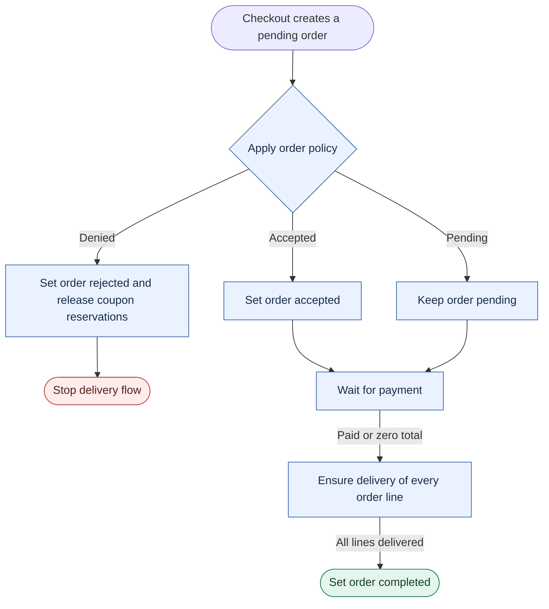
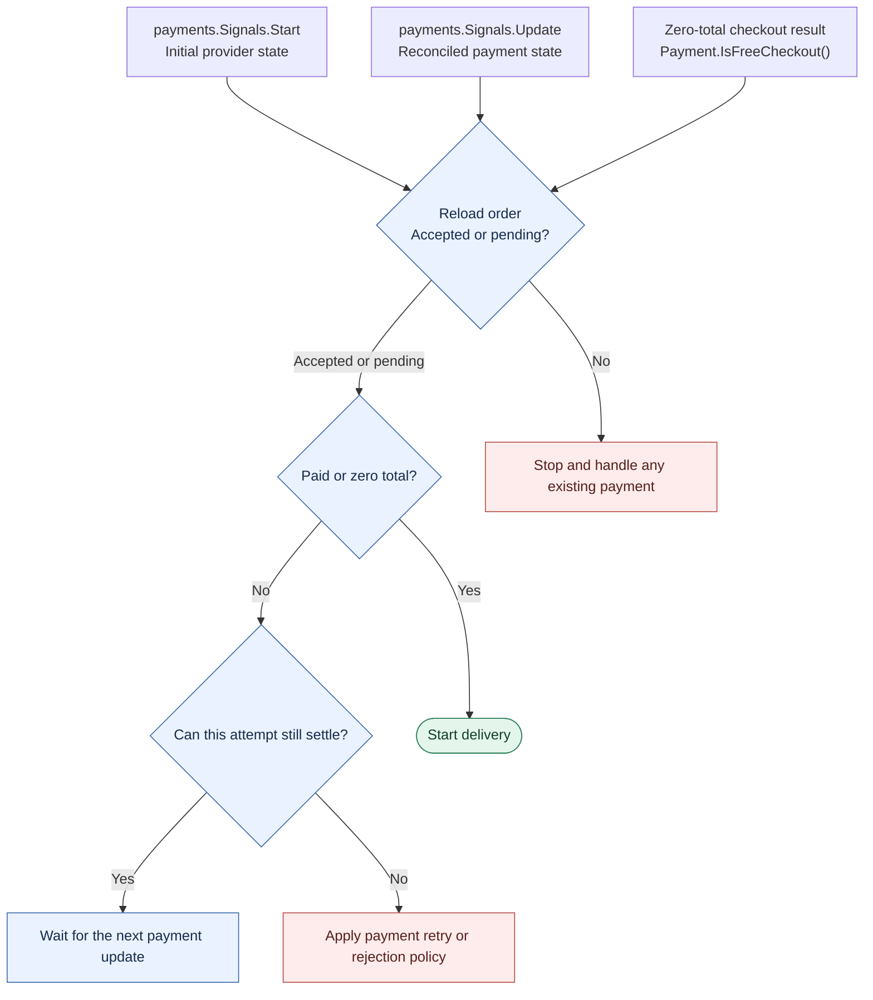
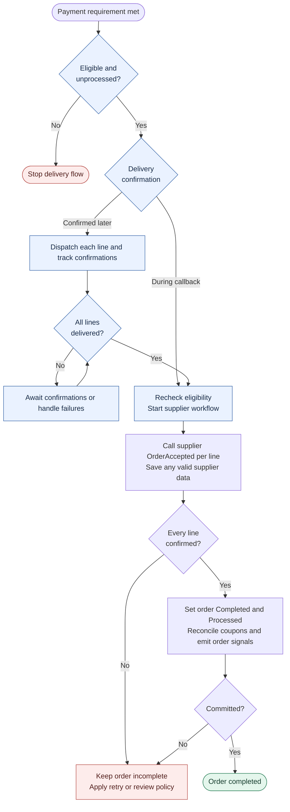

# Signals, Order Flow & Audit Logs

## Order Lifecycle

The application decides whether to accept, keep pending, or deny each order. Accepted and pending orders both wait for payment. Once payment is confirmed, ensure delivery of every order line before the order is recorded as completed. Zero-total orders satisfy the payment requirement at checkout.

Run all three order decisions in the [commerce tutorial](../../../examples/commerce/tutorial/README.md).

Blue nodes are application logic. Green nodes are successful outcomes. Red nodes show where the flow stops or needs recovery.



### Order Decision and Payment

1. Implement the order decision in your application. Use `orders.Signals.Created` to evaluate the newly created order in the checkout transaction, or save the decision later through your own handler or the admin. `CheckoutCart` opens provider checkout for a nonzero total before it creates the order and records its payment. If your policy must block the provider checkout itself, check it before calling `CheckoutCart`. When your own handler saves `OrderStateRejected`, call `orders.ReconcileCouponRedemptions` in the same transaction to release outstanding reservations. Decide how to cancel or refund any existing payment attempt.
2. Route `payments.Signals.Start` and `payments.Signals.Update` to the same payment handler. The initial provider status can already be `STATUS_PAID`. Later updates can arrive through a webhook or `payments.Refresh`. For zero-total checkout, route `CheckoutResult.Payment` with `IsFreeCheckout()` or read the committed internal payment record when using the stock HTTP endpoint. Free checkout emits neither payment signal.
3. Reload the associated order and evaluate its current state. Use `STATUS_PAID` for confirmed provider payment and `Payment.IsFreeCheckout()` for the zero-total path. Keep waiting while payment is open or under verification. Apply your retry or rejection policy when an attempt fails, expires, or is cancelled. A provider's `STATUS_DENIED` is a payment outcome. The application decides whether to set the order to `OrderStateRejected`.



Payment listeners run inside database transactions. Record delivery work in the same transaction and have a worker act on committed records. Key the work by order or order line so repeated payment notifications and worker retries can safely reuse it. See [Payments & Checkout](payments-and-checkout.md) for provider setup and reconciliation.

### Delivery and Completion

Send `orders.Signals.Completed` to start the built-in supplier workflow. Each `SupplierBackend.OrderAccepted` call confirms delivery for one order line by returning a nil error. Only after every line succeeds does the workflow set `Order.Completed` and `Order.Processed` to `true`, reconcile coupons, and emit the order-level `orders.Signals.Accepted` and `orders.Signals.Processed` before committing.

- **Delivery confirmed during the supplier callback.** Start the workflow once payment is confirmed and the order is eligible. Have `OrderAccepted` return success after delivering the line. Make external delivery calls idempotent so a database rollback and retry can reuse an earlier delivery.
- **Delivery confirmed later.** Dispatch and track delivery in the application after payment. Start the supplier workflow when all confirmations are available. Have `OrderAccepted` verify the existing delivery result for its line.



Implement delivery and its metadata schema through the [supplier backend](suppliers.md). See the [workflow execution steps](#execution-steps) for the transaction details.

---

## `shared/signals` (`contrib/shop/shared/signals/signals.go`)

```go
type BaseSignal struct {
	Request *http.Request
}

type Signal[T any] = signals.Signal[T]

type Changed[TYP any] struct {
	Old TYP
	New TYP
}

type ModelSignals[SIGNAL_T any] struct {
	Created signals.Signal[SIGNAL_T]
	Updated signals.Signal[SIGNAL_T]
	Deleted signals.Signal[SIGNAL_T]
}

var Pool = signals.NewGPool()
```

All shop signal managers retrieve typed `signals.Signal[T]` instances from `signals.Pool` using dotted string names. Returning an error from a listener registered on a signal that fires inside a database transaction aborts and rolls back that transaction.

---

## Complete Signal Reference

### `products.Signals` (`contrib/shop/products/signals.go`)

| Field | Pool Name | Payload Struct | When It Fires & Transaction Scope |
| --- | --- | --- | --- |
| `Created` | `"shop.products.Product.Created"` | `ProductCreatedSignal{ BaseSignal; Product *Product; Specific ProductModel }` | Admin product creation (`view_product.go` `ViewAddProduct` `SuccessFn`), **inside** the save transaction before `tx.Commit` |
| `Updated` | `"shop.products.Product.Updated"` | `ProductUpdatedSignal{ BaseSignal; Product signals.Changed[*Product]; Specific signals.Changed[ProductModel] }` | Admin product edit (`view_product.go` `ViewEditProduct` `SuccessFn`), **inside** the save transaction before `tx.Commit` |

### `carts.Signals` (`contrib/shop/carts/signals.go`)

Note: `CartAPISignal` and `CartItemAPISignal` do not embed `signals.BaseSignal`; they declare `Cart *Cart`, `Request *http.Request`, and `User authentication.User` directly.

| Field | Pool Name | Payload Struct | When It Fires & Transaction Scope |
| --- | --- | --- | --- |
| `Created` | `"shop.carts.Cart.Created"` | `CartAPISignal{ Cart *Cart; Request *http.Request; User authentication.User }` | `getOrCreateCart` (**outside** an outer tx for `GetOrCreateCart` after `CalcOneOrCreate` commits; **inside** `SetCustomer`'s tx and `ClearCart`'s tx when an active cart existed) and `AddCartItem` (**inside** tx before `tx.Commit`) when a new cart is created |
| `Cleared` | `"shop.carts.Cart.Cleared"` | `CartAPISignal{ Cart *Cart; Request *http.Request; User authentication.User }` | `ClearCart` (**inside** tx after deactivating the cart and invalidating unattached coupon redemptions) |
| `Item.Add` | `"shop.carts.CartItem.Add"` | `CartItemAPISignal{ CartAPISignal; CartItem *CartItem }` | `AddCartItem` (**inside** tx before `tx.Commit`) |
| `Item.Remove` | `"shop.carts.CartItem.Remove"` | `CartItemAPISignal{ CartAPISignal; CartItem *CartItem }` | `RemoveCartItem` (**inside** tx before `tx.Commit`) |

### `coupons.Signals` (`contrib/shop/coupons/signals.go`)

| Field | Pool Name | Payload Struct | When It Fires & Transaction Scope |
| --- | --- | --- | --- |
| `Created` | `"shop.coupons.Coupon.Created"` | `CouponCreatedSignal{ BaseSignal; Coupon *Coupon }` | Declared for coupon creation listeners (registered in `handlers`) |
| `Updated` | `"shop.coupons.Coupon.Updated"` | `CouponUpdatedSignal{ BaseSignal; Coupon *Coupon }` | Declared for coupon update listeners (registered in `handlers`) |
| `Redeemed` | `"shop.coupons.Coupon.Redeemed"` | `CouponRedeemedSignal{ BaseSignal; Coupon *Coupon; Cart attrs.Definer }` | `RedemptionAPI.RedeemCode` (`POST /api/coupons/redeem`), **inside** the redemption transaction before `tx.Commit` |

### `orders.Signals` (`contrib/shop/orders/signals.go`)

| Field | Pool Name | Payload Struct | When It Fires & Transaction Scope |
| --- | --- | --- | --- |
| `Created` | `"shop.orders.Order.Created"` | `OrderCreatedSignal{ BaseSignal; Order *Order; Lines []*OrderItem }` | `orders.CreateOrder` / `CreateOrderFromCart` (**inside** tx before `tx.Commit`) and admin order add (`view_order.go`, **inside** form save tx) |
| `Updated` | `"shop.orders.Order.Updated"` | `OrderUpdatedSignal{ BaseSignal; Order *Order; Lines []*OrderItem }` | Admin order edit (`view_order.go`, **inside** form save tx after `ReconcileCouponRedemptions`) |
| `Accepted` | `"shop.orders.Order.Accepted"` | `OrderAcceptedSignal{ BaseSignal; Order *Order; Lines []*OrderItem }` | Emitted **inside** the built-in workflow transaction after every supplier callback succeeds and the order is marked complete. Custom workflows can also emit it. |
| `Processed` | `"shop.orders.Order.Processed"` | `OrderProcessedSignal{ BaseSignal; Order *Order }` | Emitted by the built-in `orders.Signals.Completed` workflow (`orders/supplier_workflow.go`, **inside** tx after `Accepted`) or custom workflow handlers |
| `Completed` | `"shop.orders.Order.Completed"` | `OrderCompletedSignal{ BaseSignal; Order *Order }` | Emitted by applications when an order is ready for fulfillment; triggers the built-in listener in `orders/supplier_workflow.go` |

### `payments.Signals` (`contrib/shop/payments/signals.go`)

| Field | Pool Name | Payload Struct | When It Fires & Transaction Scope |
| --- | --- | --- | --- |
| `Start` | `"shop.payments.Payment.Start"` | `PaymentStartedSignal{ BaseSignal; Payment *Payment }` | `payments.RecordPayment` (**inside** tx when a provider checkout is persisted) |
| `Update` | `"shop.payments.Payment.Update"` | `PaymentUpdatedSignal{ BaseSignal; Payment *Payment; PreviousState string }` | `applyStatus` via `Refresh` / `ServeWebhook` (when `State` changes, **inside** tx; not fired for `ProviderFee`-only updates), `payments.Refund` (if state changed, **inside** tx), and `payments.Cancel` (if state changed, **inside** tx) |
| `Refund` | `"shop.payments.Payment.Refund"` | `PaymentRefundedSignal{ BaseSignal; Payment *Payment; RequestID string; Amount price.Money; Result RefundResult }` | `payments.Refund` (**inside** tx after `Refunder.RefundPayment` succeeds) |
| `Cancel` | `"shop.payments.Payment.Cancel"` | `PaymentCancelledSignal{ BaseSignal; Payment *Payment; RequestID string }` | `payments.Cancel` (**inside** tx after `Canceller.CancelPayment` succeeds) |

---

## Order Creation (`orders.CreateOrder` & `orders.CreateOrderFromCart`)

Implemented in `contrib/shop/orders/models_order_create.go`:

- `CreateOrder(r *http.Request, customer *customers.Customer, cart *carts.Cart, items ...*carts.CartItem) (*Order, []*OrderItem, error)` creates an order from a cart and optional explicit item list.
- `CreateOrderFromCart(r *http.Request, customer *customers.Customer, cart *carts.CartRow) (*Order, []*OrderItem, error)` requires a non-nil priced `*carts.CartRow` (typically from `CartQuery.CalcOneWithProducts()`) with at least one item.

Inside a database transaction:
1. Initializes `&Order{ State: OrderStatePending, Customer: customer }`.
2. Loads each item's specific `products.ProductModel` via `SpecificContentType` and `SpecificID`.
3. Builds `OrderItem` rows with a `ProductData` JSON snapshot (`Product` + `Specific` `ProductModel`), `ItemPrice`, `TaxRate`, `Amount`, `Supplier`, and (when `pricedCart != nil`) `Pricing.Data = &OrderItemPricing{ Totals: line.CalculatedPrice, RedemptionAmounts: maps.Clone(line.RedemptionAmounts) }`.
4. Persists the `Order` and bulk-creates the `OrderItem` rows.
5. If `pricedCart != nil && len(pricedCart.RedemptionAmounts) != 0`, iterates `pricedCart.RedemptionAmounts` in **sorted redemption ID order** and updates each `coupons.Redemption` (`ID = id`, `Cart = cart.ID`, `Invalidated = false`, `Order__isnull = true`) with `Order`, `Customer`, and `DiscountAmount`. If `count != 1`, aborts with `orders.ErrCartRedemptionsChanged`.
6. Fires `orders.Signals.Created` (`OrderCreatedSignal{ Request: r.WithContext(ctx), Order: order, Lines: orderItems }`) **inside the transaction** before `tx.Commit(ctx)`.

---

## Built-In Supplier Fulfillment Workflow (`contrib/shop/orders/supplier_workflow.go`)

`orders/supplier_workflow.go` registers an `init()` listener (`handleOrderCompleted`) on `orders.Signals.Completed`.

### Sentinel Errors

- `orders.ErrOrderRequired`: `sig.Order` is nil or has a zero `ID`.
- `orders.ErrOrderRejected`: the order is already in `OrderStateRejected`.
- `orders.ErrSupplierNotFound`: an `OrderItem` has an empty supplier or its supplier is not in the in-memory registry.
- `orders.ErrSupplierDisabled`: a `SupplierModel` row exists in the database with `Enabled == false`.
- `orders.ErrInvalidSupplierData`: data returned by `SupplierBackend.OrderAccepted` fails `OrderBlock` binding or validation.

### Execution Steps

When an application sends `orders.Signals.Completed.Send(ctx, orders.OrderCompletedSignal{Order: order})`:
1. Validates `sig.Order` and `queries.IsCommitContext(ctx)`.
2. Starts/joins a database transaction and locks the `Order` row (`BulkUpdate(expr.As("Completed", expr.Field("Completed")))`), then loads `Order` with `Customer.*`.
3. If `order.State == OrderStateRejected`, returns `ErrOrderRejected`.
4. If `order.Processed == true`, commits and syncs `sig.Order` (idempotent no-op).
5. Loads all `OrderItem` rows for the order (`OrderBy("ID")`) and saves `order.State = OrderStateWorkflow`.
6. For each `OrderItem`:
   - Resolves `item.Supplier` (falling back to `item.Product.Data.Product.Supplier`), looks up the registered `SupplierBackend`, and verifies the supplier is not disabled in `orders.SupplierModel`.
   - Calls `backend.OrderAccepted(ctx, order, item)` to confirm delivery, including for lines that already have `SupplierData`. If the callback returns a non-nil `*blocks.StructBlockValue`, binds it to the supplier's `OrderBlock` when needed, validates it when a block is available, and persists `OrderItem.SupplierData`.
7. Once all callbacks and any supplier data validation succeed, saves `order.State = OrderStateAccepted`, `order.Completed = true`, and `order.Processed = true`.
8. Calls `orders.ReconcileCouponRedemptions(ctx, order.ID)` to count pending coupon redemptions toward `Coupon.UsageCount`.
9. Emits `orders.Signals.Accepted` (`OrderAcceptedSignal`) and `orders.Signals.Processed` (`OrderProcessedSignal`) inside the transaction, commits, and syncs `State`, `Completed`, `Processed`, and `Customer` back onto `sig.Order`.

If the workflow joins your transaction, commit it after the workflow succeeds or roll it back on error.

---

## Order States & Transitions (`contrib/shop/orders/models_order_state.go`)

`Order.State` has type `InternalOrderState` (`string`), and `Order` also tracks boolean flags `Processed` and `Completed`. `OrderState` is a model with `ID`, `Label`, `Action InternalOrderState`, and `WorkflowID drivers.ULID`.

Exported `InternalOrderState` constants:
- `orders.OrderStatePending` (`"order_pending"` — `"Order Pending"`): initial state set by `createOrder`.
- `orders.OrderStateAccepted` (`"order_accepted"` — `"Order Accepted"`): can be set by the application's order decision before payment. The built-in workflow also saves this state together with `Completed = true` and `Processed = true`.
- `orders.OrderStateRejected` (`"order_rejected"` — `"Order Rejected"`): rejected order; blocks fulfillment and invalidates pending coupon reservations.
- `orders.OrderStateWorkflow` (`"order_workflow"` — `"Order Workflow"`): transient state set while `handleOrderCompleted` runs supplier fulfillment.

Transitions happen via:
- **Payment signal listeners -> `orders.Signals.Completed`**: applications listen to `payments.Signals.Start` and `payments.Signals.Update` and send `orders.Signals.Completed` once payment is verified, letting `orders/supplier_workflow.go` advance `State` / `Completed` / `Processed`, reconcile coupons, and emit `Accepted` / `Processed`.
- **Admin order edit** (`view_order.go`), which saves `Order`, runs `orders.ReconcileCouponRedemptions(ctx, p.ID)`, and fires `orders.Signals.Updated` in the same transaction.
  - When `Order.State == OrderStateRejected`, `ReconcileCouponRedemptions` invalidates pending coupon reservations (`Invalidated = true`).
  - When `Order.Completed == true`, `ReconcileCouponRedemptions` marks pending coupon reservations `Counted = true` and increments `Coupon.UsageCount`.

---

## Audit Logs (`contrib/shop/handlers/`)

`NewAppConfig()` in `contrib/shop/app.go` calls `handlers.RegisterAuditLogs()`, which uses `sync.Once` to register all `auditlogs.Definition` types and attach listeners to every shop signal. `logAudit` silently ignores `auditlogs.ErrLogsNotReady`.

### Registered Audit Log Definitions & Listeners

| Audit Kind | Signal Listened | Level | `Definition` Struct | Data Keys Recorded |
| --- | --- | --- | --- | --- |
| `"shop:product:add"` | `products.Signals.Created` | `INF` | `productAddedDefinition` | `title` |
| `"shop:product:edit"` | `products.Signals.Updated` | `INF` | `productEditedDefinition` | `title`, `changes` |
| `"shop:carts:create"` | `carts.Signals.Created` | `INF` | `cartCreatedDefinition` | _(none)_ |
| `"shop:carts:clear"` | `carts.Signals.Cleared` | `INF` | `cartClearedDefinition` | _(none)_ |
| `"shop:carts:items:add"` | `carts.Signals.Item.Add` | `INF` | `cartItemAddedDefinition` | `cart_id` |
| `"shop:carts:items:remove"` | `carts.Signals.Item.Remove` | `INF` | `cartItemRemovedDefinition` | `cart_id` |
| `"shop:coupons:create"` | `coupons.Signals.Created` | `INF` | `couponCreatedDefinition` | `title` |
| `"shop:coupons:update"` | `coupons.Signals.Updated` | `INF` | `couponUpdatedDefinition` | `title` |
| `"shop:coupons:redeem"` | `coupons.Signals.Redeemed` | `INF` | `couponRedeemedDefinition` | `title`, `cart_id` |
| `"shop:orders:create"` | `orders.Signals.Created` | `INF` | `orderCreatedDefinition` | `state`, `line_count` |
| `"shop:orders:update"` | `orders.Signals.Updated` | `INF` | `orderUpdatedDefinition` | `state`, `line_count` |
| `"shop:orders:accept"` | `orders.Signals.Accepted` | `INF` | `orderAcceptedDefinition` | `state`, `line_count` |
| `"shop:orders:process"` | `orders.Signals.Processed` | `INF` | `orderProcessedDefinition` | `state` |
| `"shop:orders:complete"` | `orders.Signals.Completed` | `INF` | `orderCompletedDefinition` | `state` |
| `"shop:payments:start"` | `payments.Signals.Start` | `paymentStateLevel` (`ERR` for `FAILURE`, `WRN` for `DENIED`/`VERIFY`/`PAID_CHECKAMOUNT`/`CHARGEBACK`, else `INF`) | `paymentStartedDefinition` | `state`, `amount`, `currency`, `provider`, `account_id`, `order_id` |
| `"shop:payments:update"` | `payments.Signals.Update` | `paymentStateLevel` | `paymentUpdatedDefinition` | `paymentAudit` keys + `previous_state` |
| `"shop:payments:refund"` | `payments.Signals.Refund` | `INF` | `paymentRefundedDefinition` | `paymentAudit` keys + `request_id`, `refund_amount`, `refund_currency` |
| `"shop:payments:cancel"` | `payments.Signals.Cancel` | `INF` | `paymentCancelledDefinition` | `paymentAudit` keys + `request_id` |

Shared action helpers in `handlers/auditlogs_definition.go`:
- `shopEditAuditAction`: builds an `"admin:apps:model:edit"` action with `?next=<r.URL.Path>` when the user has `admin:edit` and any extra required permissions (`"products:edit"`, `"orders:edit"`).
- `shopListAuditAction`: builds an `"admin:apps:model"` action when the user has `admin:view_list` (used by cart and payment audit entries).
