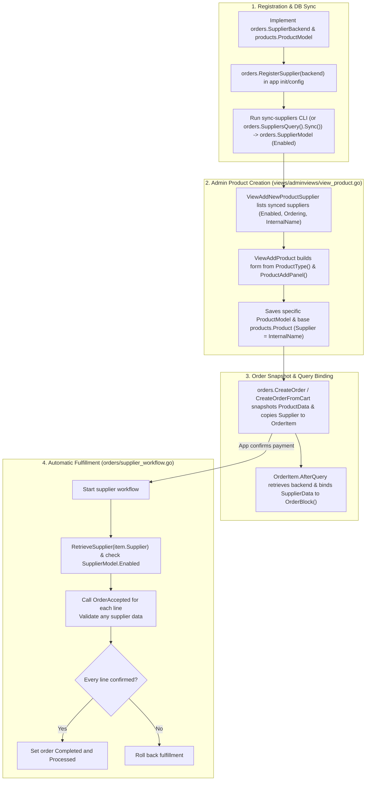

# Suppliers

The `contrib/shop/orders` package implements a pluggable supplier architecture that decouples product definitions and order-item fulfillment metadata from the core shop models. Each supplier is registered in code as a `SupplierBackend`, synchronized into the database as a `SupplierModel` row, and referenced by `products.Product` and `orders.OrderItem` via `products.SupplierValue`.

---

## Supplier Lifecycle & Fulfillment Flow

For the application's handoff from confirmed payment to delivery and order completion, see the [delivery and completion flow](signals-and-order-flow.md#delivery-and-completion).



---

## Core Interfaces and Types

### `SupplierBackend`

Defined in [`contrib/shop/orders/supplier_backend.go`](../orders/supplier_backend.go), every supplier implementation must satisfy `SupplierBackend`:

```go
type SupplierBackend interface {
	Ordering() int // lowest first, defaults to InternalName otherwise
	InternalName() string
	Icon(ctx context.Context) template.HTML
	Label(ctx context.Context) string
	Description(ctx context.Context) string

	ProductType(ctx context.Context) products.ProductModel
	ProductAddPanel(ctx context.Context) []admin.Panel
	ProductEditPanel(ctx context.Context) []admin.Panel

	OrderBlock(ctx context.Context, order *Order, orderItem *OrderItem) (blocks.Block, error)
	OrderAccepted(ctx context.Context, order *Order, orderItem *OrderItem) (*blocks.StructBlockValue, error)
}
```

| Method | Purpose |
| --- | --- |
| `Ordering()` | Sort priority (lowest value first; ties break by `InternalName()`). |
| `InternalName()` | Unique string identifier stored in `SupplierModel.InternalName`, `Product.Supplier`, and `OrderItem.Supplier`. |
| `Icon(ctx)` | HTML icon rendered in the admin supplier chooser. |
| `Label(ctx)` | Human-readable display name. |
| `Description(ctx)` | Descriptive text shown when choosing a supplier in the admin. |
| `ProductType(ctx)` | Returns a fresh `products.ProductModel` instance representing the supplier-specific product model. |
| `ProductAddPanel(ctx)` | Returns the `admin.Panel` slice used when creating a product for this supplier. |
| `ProductEditPanel(ctx)` | Returns the `admin.Panel` slice used when editing a product for this supplier. |
| `OrderBlock(ctx, order, orderItem)` | Returns the `blocks.Block` schema used to bind `OrderItem.SupplierData` after querying. |
| `OrderAccepted(ctx, order, orderItem)` | Returns a nil error when the supplier has confirmed delivery for the line. It can also return supplier data such as a receipt. Implement idempotent delivery for retries. |

### `CatalogableSupplierBackend`

An optional capability interface in [`contrib/shop/orders/supplier_backend.go`](../orders/supplier_backend.go) for suppliers that can expose a product catalog:

```go
type CatalogableSupplierBackend interface {
	Catalog(ctx context.Context) ([]products.ProductModel, error)
}
```

### `Supplier` (Declarative Struct Implementation)

[`contrib/shop/orders/supplier.go`](../orders/supplier.go) provides `orders.Supplier`, a callback-based implementation of `SupplierBackend`:

```go
type Supplier struct {
	Order           int
	Name            string
	HTMLIcon        func(ctx context.Context) template.HTML
	TextLabel       func(ctx context.Context) string
	TextDescription func(ctx context.Context) string
	ProductModel    func(ctx context.Context) products.ProductModel
	AddPanel        func(ctx context.Context) []admin.Panel
	EditPanel       func(ctx context.Context) []admin.Panel
	OrderBlockType  func(ctx context.Context, order *Order, orderItem *OrderItem) (blocks.Block, error)
	OrderIsAccepted func(ctx context.Context, order *Order, orderItem *OrderItem) (*blocks.StructBlockValue, error)
}
```

All callback fields are nil-safe:
- `Icon`, `Description`, `ProductType`, `ProductAddPanel`, `ProductEditPanel`, `OrderBlock`, and `OrderAccepted` return zero values (`""` / `nil` / `nil, nil`) when their callback is `nil`.
- `Label` falls back to `attrs.NiceName(s.Name)` when `TextLabel` is `nil`.

Set `OrderIsAccepted` for suppliers that deliver goods or services. The workflow treats a nil error as confirmation even when the callback returns no metadata.

```go
orders.RegisterSupplier(&orders.Supplier{
	Order: 10,
	Name:  "digital_download",
	TextLabel: trans.S("Digital Download"),
	ProductModel: func(ctx context.Context) products.ProductModel {
		return &MyDigitalProduct{}
	},
	AddPanel: func(ctx context.Context) []admin.Panel {
		return (&MyDigitalProduct{}).AddPanels(ctx)
	},
	EditPanel: func(ctx context.Context) []admin.Panel {
		return (&MyDigitalProduct{}).EditPanels(ctx)
	},
	OrderIsAccepted: deliverDownload,
})
```

### `BoundSupplierBackend`

`BoundSupplierBackend` ([`contrib/shop/orders/supplier_backend.go`](../orders/supplier_backend.go)) pairs a `SupplierBackend` with a `context.Context` and an optional `*SupplierModel` database row so templates can call parameterless methods:

```go
type BoundSupplierBackend struct {
	Context  context.Context
	Instance *SupplierModel
	SupplierBackend
}
```

It provides `Icon() template.HTML`, `Label() string`, and `Description() string` delegating to the underlying `SupplierBackend` with `b.Context`.

---

## Registry Functions

The global supplier registry is backed by an `orderedmap.OrderedMap[string, SupplierBackend]` in [`contrib/shop/orders/supplier_registry.go`](../orders/supplier_registry.go) and exposed through package-level functions in [`contrib/shop/orders/supplier_backend.go`](../orders/supplier_backend.go):

| Function | Signature | Behavior |
| --- | --- | --- |
| `RegisterSupplier` | `RegisterSupplier(b SupplierBackend)` | Registers (or replaces) `b` keyed by `b.InternalName()`. |
| `RetrieveSupplier` | `RetrieveSupplier[S ~string](name S) (SupplierBackend, bool)` | Looks up a backend by name (accepts `string` or `products.SupplierValue`). |
| `SupplierBackendCount` | `SupplierBackendCount() int` | Returns the number of registered backends. |
| `IterSupplierBackends` | `IterSupplierBackends(useOrdering bool) iter.Seq2[int, SupplierBackend]` | Iterates over backends. When `useOrdering` is `true`, sorts stably by `Ordering()` ascending, then `InternalName()` ascending; when `false`, preserves registration order. |
| `BoundSupplierBackends` | `BoundSupplierBackends(ctx context.Context) []BoundSupplierBackend` | Returns all backends wrapped with `ctx` in `IterSupplierBackends(true)` order (`Instance` is `nil`). |

---

## Database Model and Synchronization

### `SupplierModel`

Defined in [`contrib/shop/orders/supplier_model.go`](../orders/supplier_model.go), `SupplierModel` persists registered suppliers in the database and tracks whether each supplier is enabled:

| Field | Type | Configuration |
| --- | --- | --- |
| `InternalName` | `string` | Primary key, `MinLength: 2`, `MaxLength: 75`, `attrs.AttrUniqueKey: true`, unique index `supplier_internal_name_idx`, `UniqueTogether: [["InternalName"]]`. |
| `Enabled` | `bool` | `Blank: true`, `Default: true`. |

In [`contrib/shop/app.go`](../app.go), `NewAppConfig()` registers legacy contenttype aliases pointing to `&orders.SupplierModel{}`:
- `github.com/Nigel2392/go-django/contrib/shop/supplier.SupplierModel`
- `github.com/Nigel2392/go-django/contrib/shop/models/products/supplier.SupplierModel`

### `SupplierQuery` and `SuppliersQuery().Sync()`

[`contrib/shop/orders/supplier_query.go`](../orders/supplier_query.go) provides `SuppliersQuery() *SupplierQuery`, wrapping `*queries.QuerySet[*SupplierModel]`.

Synchronize registered backends with the database by running the `sync-suppliers` CLI command ([`contrib/shop/command_sync_suppliers.go`](../command_sync_suppliers.go)) or calling `orders.SuppliersQuery().WithContext(ctx).Sync()` directly. Inside a database transaction, `Sync()` performs:

1. Collects all `InternalName()` values from `IterSupplierBackends(false)`.
2. If no backends are registered, bulk-updates all `SupplierModel` rows to `Enabled = false` (ignoring `errors.NoRows`) and commits.
3. Otherwise, bulk-updates any `SupplierModel` row whose `InternalName` is not in the registered list to `Enabled = false` (ignoring `errors.NoRows`).
4. Queries existing rows matching the registered names. Existing rows keep their current `Enabled` value (manual disables are preserved).
5. Bulk-creates `&SupplierModel{InternalName: name, Enabled: true}` for any registered backend not yet present in the database, then commits.

---

## Integration with `Product` and `OrderItem`

### `products.SupplierValue` and Form Field Registration

In [`contrib/shop/products/models_product.go`](../products/models_product.go):
- `type SupplierValue string`
- `Product.Supplier` has type `SupplierValue` (JSON tag `supplier,omitempty`) and is marked `ReadOnly: true` in `Product.FieldDefs` so it is fixed once a product is created for a chosen supplier.

In `init()` of [`contrib/shop/orders/supplier.go`](../orders/supplier.go), `attrs.RegisterFormFieldType` registers a form field factory for `products.SupplierValue` that renders a `fields.CharField` with an `options.NewSelectInput` populated from `IterSupplierBackends(true)`.

When creating a product in the admin (`ViewAddNewProductSupplier` -> `ViewAddProduct` in [`contrib/shop/views/adminviews/view_product.go`](../views/adminviews/view_product.go)), the selected backend's `InternalName()` is assigned to `product.Supplier`.

### `OrderItem` and `AfterQuery` Binding

In [`contrib/shop/orders/models_order_create.go`](../orders/models_order_create.go), `CreateOrder` copies `cartItem.Product.Supplier` onto `OrderItem.Supplier` alongside the `ProductData` JSON snapshot.

[`contrib/shop/orders/models_order_item.go`](../orders/models_order_item.go) defines:
- `OrderItem.Supplier` (`products.SupplierValue`, non-null, non-blank) — stored as a top-level column for querying without inspecting `Product` JSON.
- `OrderItem.SupplierData` (`*blocks.StructBlockValue`, nullable, with `blocks.AttrKeyBlockControl: true`) — holds supplier-specific fulfillment data.
- `OrderItem.supplierBlock` (`blocks.Block`, unexported, `json:"-"`) — bound dynamically after queries.

`OrderItem.AfterQuery(ctx)` runs automatically when an `OrderItem` is loaded:
1. If `m.Supplier == ""` and `m.Product.Data.Product != nil`, it backfills `m.Supplier = m.Product.Data.Product.Supplier`.
2. Calls `RetrieveSupplier(m.Supplier)`. If the supplier is not registered:
   - Returns `nil` when `!m.SupplierData.HasData()`.
   - Returns `errors.CorruptedData` (`supplier %q does not exist`) when `m.SupplierData.HasData()` is true.
3. Calls `supplier.OrderBlock(ctx, m.Order, m)` to obtain `m.supplierBlock`.
4. If both `m.supplierBlock` and `m.SupplierData` are non-nil, binds the stored data to the block schema via `m.SupplierData.BindToBlock(m.supplierBlock)`.

---

## Automatic Fulfillment Workflow (`orders/supplier_workflow.go`)

[`contrib/shop/orders/supplier_workflow.go`](../orders/supplier_workflow.go) registers an `init()` listener on `orders.Signals.Completed` that fulfills each `OrderItem` through its registered `SupplierBackend` inside a database transaction:

1. Locks the `Order` row and rejects already-rejected orders (`orders.ErrOrderRejected`) or skips already-processed orders (`order.Processed == true`).
2. Saves `OrderStateWorkflow` and iterates the order lines by `ID`.
3. Resolves each line's supplier, falling back to `item.Product.Data.Product.Supplier`. Requires a registered backend (`orders.ErrSupplierNotFound`) and checks for a disabled `orders.SupplierModel` (`orders.ErrSupplierDisabled`).
4. Calls `backend.OrderAccepted(ctx, order, item)` for every line, including lines with existing `SupplierData`. A nil error confirms delivery for the line. If the callback returns data, the workflow binds and validates it against any configured `OrderBlock` and saves it to `OrderItem.SupplierData`.
5. After every line succeeds, saves `OrderStateAccepted`, `Completed = true`, and `Processed = true`. It reconciles coupon redemptions and emits the order-level `orders.Signals.Accepted` and `orders.Signals.Processed` before committing. If the workflow joins your transaction, roll it back on error.
