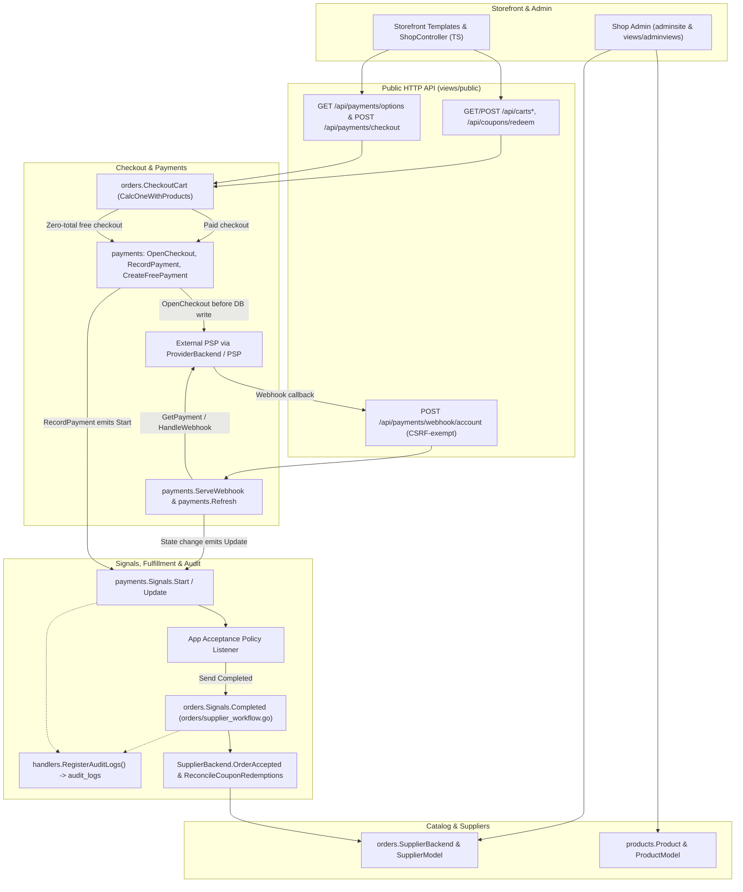
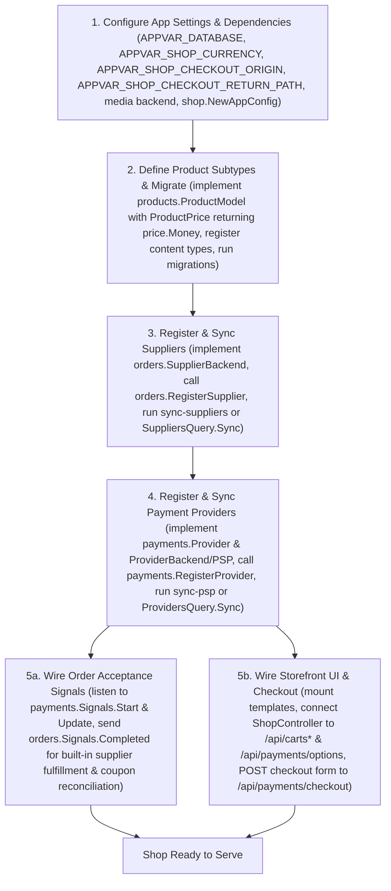

# Shop (`contrib/shop`)

`contrib/shop` is a modular e-commerce application for Go-Django (`github.com/Nigel2392/go-django/contrib/shop`). It provides product catalogs with polymorphic product subtypes, hierarchical categories, session- and user-scoped shopping carts (with optional guest customer details), coupon codes and redemptions, supplier fulfillment backends, customer records, signal-driven order creation and fulfillment, code-first payment provider orchestration, public JSON/HTTP APIs, a TypeScript storefront client, CLI sync commands, and `contrib/admin` integration.

---

## Architecture

`contrib/shop` is organized around domain packages backed by Go-Django's `queries` ORM, `attrs` field definitions, `specific` model inheritance, and a typed signal bus (`shared/signals`):

1. **Catalog & Suppliers (`products`, `models`, `orders/supplier*.go`)**:
   - `products.Product` uses `queries/src/specific` so applications can define custom product types implementing `products.ProductModel` (`ProductPrice(ctx context.Context) price.Money`) alongside shared base fields (`Price`, `AdditionalFee`, `TaxRate`, `DiscountPrice`, `Category`, `Supplier`).
   - Delivery and fulfillment are delegated to registered `orders.SupplierBackend` implementations, synchronized into `orders.SupplierModel` rows via the `sync-suppliers` CLI command or `orders.SuppliersQuery().Sync()`.
2. **Carts & Coupons (`carts`, `coupons`)**:
   - `carts.Cart` and `carts.CartItem` track active shopping carts scoped to the authenticated user or HTTP session, with an optional `Customer` link (`carts.SetCustomer` / `POST /api/carts/customer`) enabling guest checkout.
   - `coupons.Coupon`, `coupons.CouponProductThrough`, and `coupons.Redemption` support percentage and fixed-amount discounts, product-targeted or cart-wide rules, minimum order amounts, validity windows, and usage limits.
   - `carts.CartQuery.Calc()` / `CalcOne()` / `CalcOneWithProducts()` compute line-level and cart-level `price.Totals` inside a database transaction (preloading `Customer` and `CartItems`).
3. **Checkout & Payments (`orders/checkout.go`, `payments`)**:
   - `orders.CheckoutCart` prices an active cart (via `Cart.Totals.Payable()` or a custom `orders.CheckoutPricer`), opens checkout with the payment service provider (`payments.OpenCheckout`) before mutating the database, and then atomically deactivates the cart, creates the `Order` and `OrderItem` snapshots, invalidates unapplied cart coupons, and records the `Payment` (`payments.RecordPayment`, or `payments.CreateFreePayment` for zero-total orders).
   - `payments` keeps provider configuration, fees, currency, and credentials strictly in Go code via `ProviderBackend` / `PSP` registrations, synchronized into `ProviderAccount` enable/disable rows via the `sync-psp` CLI command or `payments.ProvidersQuery().Sync()`. It handles webhooks (`ServeWebhook`), status reconciliation (`Refresh`), free checkouts (`IsFreeCheckout()`), and post-payment `Refund` / `Cancel` operations.
4. **Signal-Driven Order Lifecycle (`orders`, `shared/signals`, `handlers`)**:
   - Domain packages emit typed signals on `shared/signals.Pool` during cart, coupon, product, order, and payment transitions.
   - `orders.CreateOrder` / `orders.CreateOrderFromCart` snapshot cart lines and pricing into `Order` and `OrderItem` records inside a transaction and emit `orders.Signals.Created`.
   - `orders/supplier_workflow.go` registers a built-in listener on `orders.Signals.Completed` that validates and invokes each line's `SupplierBackend.OrderAccepted` / `OrderBlock`, transitions the order through `OrderStateWorkflow` to `OrderStateAccepted` (`Completed = true`, `Processed = true`), reconciles coupon usage (`orders.ReconcileCouponRedemptions`), and emits `orders.Signals.Accepted` and `orders.Signals.Processed`.
   - `handlers.RegisterAuditLogs()` subscribes to all shop domain signals to record `contrib/reports/audit_logs` entries.
5. **HTTP APIs, Admin & Frontend (`views/public`, `views/adminviews`, `adminsite`, `assets`)**:
   - Public JSON endpoints under `/api/carts`, `/api/coupons`, and `/api/payments`, using the `shared/api` `DataResponse[T]` / `ErrorResponse` JSON envelope.
   - Admin model registrations in `contrib/shop/adminsite`, custom views in `views/adminviews`, and an admin coupon-generator endpoint.
   - Embedded Go templates, static assets, and a TypeScript storefront API client (`assets/static_src`).

### Architecture & Request Flow



---

## Package Map

| Package | Purpose |
| :--- | :--- |
| `contrib/shop` (`app.go`, `http.go`, `command_sync_*.go`) | `ShopAppConfig` (`SHOP`, `NewAppConfig()`), model/admin/route/command registration (`sync-psp`, `sync-suppliers`), `ShopHandler`, `ShopInstanceHandler`. |
| `contrib/shop/adminsite` | Admin `ModelOptions` (`CategoryAdmin`, `ProductAdmin`, `OrdersAdmin`, `CouponsAdmin`, `CustomersAdmin`), `ShopHandler`, `ShopInstanceHandler`. |
| `contrib/shop/models` | `Category` model and `CategoryQuery`. |
| `contrib/shop/products` | `Product` base model, `ProductModel` interface, `SupplierValue`, `ProductQuery`, and product signals. |
| `contrib/shop/customers` | `Customer` model linked optionally to `users.User`. |
| `contrib/shop/carts` | `Cart` (with optional `Customer`), `CartItem`, `CustomerDetails`, `SetCustomer`, `CartQuery` (`Calc`, `CalcOne`, `CalcOneWithProducts`, `CartForRequest`), `CartRow`, `CartItemRow`, and cart signals. |
| `contrib/shop/coupons` | `Coupon`, `CouponCode`, `CouponProductThrough`, `Redemption`, and coupon signals. |
| `contrib/shop/coupons/generators` | Configurable coupon code generation (`CodePart`, `GenerateCouponCode`, `CouponGeneratorWidget`). |
| `contrib/shop/orders` | `Order`, `OrderItem`, `OrderItemPricing`, `ProductData` snapshot, `OrderState`, `InternalOrderState` (`OrderState*`), `OrderQuery`, `CreateOrder`/`CreateOrderFromCart`, `CheckoutCart`, `ReconcileCouponRedemptions`, supplier registry/backends/workflow (`supplier_workflow.go`), admin panels, and order signals. |
| `contrib/shop/payments` | `ProviderBackend`, `PSP`, `BoundProviderBackend`, `ProviderQuery`, `ProviderAccount`, `Payment`, `PaymentEvent`, `Provider`/`Refunder`/`Canceller` interfaces, service lifecycle (`OpenCheckout`, `RecordPayment`, `CreateFreePayment`, `Refresh`, `ServeWebhook`, `Refund`, `Cancel`), and payment signals. |
| `contrib/shop/shared/api` | Request/response helpers (`Response`, `DataResponse[T]`, `ErrorResponse`, `APIRequest`, `BaseAPIRequest`, `RequestRegistry`, `Decode`, `Respond`, `RespondError`). |
| `contrib/shop/shared/price` | Decimal pricing and currency helpers (`Money`, `Quote`, `QuoteFee`, `AmountValue`, `Price`, `Totals`, `PriceCalculation`). |
| `contrib/shop/shared/relations/modelkeys` | Content-type keys and lazy registries (`ProductModelKey`, `OrderModelKey`, `CartModelKey`, `CategoryModelKey`, `PaymentModelKey`, `CustomerModelKey`). |
| `contrib/shop/shared/signals` | Typed signal pool (`Pool`, `Signal[T]`, `BaseSignal`, `Changed[TYP]`, `ModelSignals`). |
| `contrib/shop/util/paystate` | `PayState` type, `PAYSTATE` checker, and 17 `STATUS_*` constants. |
| `contrib/shop/util/forms` | `NewAdminForm` helper for building `admin.AdminForm` instances. |
| `contrib/shop/handlers` | Signal listeners and `audit_logs` definitions (`RegisterAuditLogs()`). |
| `contrib/shop/views/public` | Public HTTP handlers for carts (including guest customer details), coupon redemption, payment options, and checkout. |
| `contrib/shop/views/adminviews` | Admin list/add/edit views for products and orders, coupon generator endpoint, and generic list/filter helpers. |
| `contrib/shop/assets` | Embedded templates (`assets/templates`), built static assets (`assets/static`), and TypeScript sources (`assets/static_src`). |

---

## Installation & App Registration

Register `contrib/shop` in your Go-Django application using `shop.NewAppConfig()` (which configures and returns the `shop.SHOP` `*ShopAppConfig` singleton).

### Dependencies

`SHOP.Deps` requires the following apps to be registered before `shop`:

- `"session"`
- `"admin"`
- `"editor"`
- `"blocks"`
- `"revisions"`
- `"settings"`

`shop` embeds `*apps.DBRequiredAppConfig`, so `django.APPVAR_DATABASE` must also be configured.

### App Variables

Configure `contrib/shop` behavior via `django.Settings` / `djangoapps.CONFIG`:

| Constant | Setting Key | Default | Description |
| :--- | :--- | :--- | :--- |
| `shop.APPVAR_SHOP_CURRENCY` | `"SHOP_CURRENCY"` | *(zero `currency.Unit`)* | Accepts a `currency.Unit` (e.g. `currency.EUR`), an ISO currency code `string` (e.g. `"EUR"`), or a dynamic `func(context.Context) currency.Unit` resolver passed to `public.PaymentsAPI` and `public.CheckoutAPI`. |
| `shop.APPVAR_SHOP_CHECKOUT_ORIGIN` | `"SHOP_CHECKOUT_ORIGIN"` | `""` | Base origin URL used by `public.CheckoutAPI` to build return and webhook URLs. |
| `shop.APPVAR_SHOP_CHECKOUT_RETURN_PATH` | `"SHOP_CHECKOUT_RETURN_PATH"` | `"/"` | Path appended to the origin for post-checkout customer redirects. |

### CLI Commands

`SHOP.Cmd` registers two management commands:

- `sync-psp` (`command_sync_psp.go`): Synchronizes registered `payments.ProviderBackend` implementations with the `payments.ProviderAccount` table in a transaction (`payments.ProvidersQuery().WithContext(ctx).Sync()`).
- `sync-suppliers` (`command_sync_suppliers.go`): Synchronizes registered `orders.SupplierBackend` implementations with the `orders.SupplierModel` table in a transaction (`orders.SuppliersQuery().WithContext(ctx).Sync()`).

### Example Registration

```go
package main

import (
	"github.com/Nigel2392/go-django/contrib/admin"
	"github.com/Nigel2392/go-django/contrib/blocks"
	"github.com/Nigel2392/go-django/contrib/editor"
	"github.com/Nigel2392/go-django/contrib/revisions"
	"github.com/Nigel2392/go-django/contrib/session"
	"github.com/Nigel2392/go-django/contrib/settings"
	"github.com/Nigel2392/go-django/contrib/shop"
	django "github.com/Nigel2392/go-django/src"
	"golang.org/x/text/currency"
)

func setupApp() *django.Application {
	return django.App(
		django.Configure(map[string]any{
			django.APPVAR_DATABASE:                db,
			shop.APPVAR_SHOP_CURRENCY:             currency.EUR,
			shop.APPVAR_SHOP_CHECKOUT_ORIGIN:      "https://shop.example.com",
			shop.APPVAR_SHOP_CHECKOUT_RETURN_PATH: "/checkout/complete",
		}),
		django.Apps(
			session.NewAppConfig,
			admin.NewAppConfig,
			editor.NewAppConfig,
			blocks.NewAppConfig,
			revisions.NewAppConfig,
			settings.NewAppConfig,
			shop.NewAppConfig,
		),
	)
}
```

On startup, `NewAppConfig()` registers:
- Content-type aliases for legacy `SupplierModel` paths, embedded templates/static files, the funnel icon, and the `sync-psp` / `sync-suppliers` CLI commands.
- Audit log definitions and signal listeners via `handlers.RegisterAuditLogs()`.
- All 14 shop models (`CartItem`, `Cart`, `OrderState`, `OrderItem`, `Order`, `ProviderAccount`, `Payment`, `Product`, `Category`, `SupplierModel`, `Coupon`, `CouponProductThrough`, `Redemption`, `Customer`).
- The `products.Product` admin chooser, admin app (`adminsite.CategoryAdmin`, `ProductAdmin`, `OrdersAdmin`, `CouponsAdmin`, `CustomersAdmin`), `admin:commerce:new_with_supplier`, and `admin:ext:shop:generate_coupon` routes.
- Public `/api/carts*` (including `/api/carts/customer`), `/api/coupons/redeem`, and `/api/payments/*` routes, plus a `nosurf` CSRF exemption for `/api/payments/webhook/<ULID>`.

---

## Signal-Driven Order Flow (High Level)

The shop's order lifecycle is **primarily signal-driven**:

1. **Cart & Coupon Signals**: Public API handlers emit `carts.Signals` (`Created`, `Cleared`, `Item.Add`, `Item.Remove`) and `coupons.Signals` (`Redeemed`; `Created` and `Updated` are also declared for listeners) as shoppers build carts, attach customer details (`POST /api/carts/customer`), and apply promo codes.
2. **Checkout & Order Creation**: `POST /api/payments/checkout` (or direct callers) invokes `orders.CheckoutCart`, which prices the active cart via `CalcOneWithProducts()`, opens provider checkout via `payments.OpenCheckout` (for positive balances) before mutating the database, and then atomically deactivates the cart, persists the `Order` and `OrderItem` snapshots via `orders.CreateOrderFromCart` (emitting `orders.Signals.Created`), invalidates unapplied cart coupons, and records the `Payment` via `payments.RecordPayment` (emitting `payments.Signals.Start`) or `payments.CreateFreePayment`.
3. **Webhooks, Reconciliation & Operations**: `payments.Refresh`, `payments.ServeWebhook`, `payments.Refund`, and `payments.Cancel` emit `payments.Signals` (`Update`, `Refund`, `Cancel`).
4. **Order Completion & Supplier Fulfillment**: Applications listen to `payments.Signals.Start` and `payments.Signals.Update` and, once their acceptance policy is met, emit `orders.Signals.Completed`. The built-in listener in `orders/supplier_workflow.go` then fulfills each order line through its registered `SupplierBackend`, transitions the order to `OrderStateAccepted` (`Completed = true`, `Processed = true`), reconciles coupon usage, and emits `orders.Signals.Accepted` and `orders.Signals.Processed` — while `handlers.RegisterAuditLogs()` records audit entries across all domain signals.

---

## New Shop Setup Flow

Follow these steps to integrate `contrib/shop` into a new Go-Django application:



---

## What You Need to Implement

`contrib/shop` provides the core models, checkout flow, supplier workflow, HTTP endpoints, and admin UI, and expects the host application to supply its own domain-specific extensions:

1. **Product Subtypes (`products.ProductModel`)**:
   - Define your concrete product model(s) implementing `products.ProductModel` (`specific.Model` + `ProductPrice(ctx context.Context) price.Money`) and register them as Go-Django models/content types so `products.Product` and `orders.ProductData` snapshots can resolve `SpecificContentType`.
2. **Supplier Backends (`orders.SupplierBackend`)**:
   - Implement `orders.SupplierBackend` (and optionally `orders.CatalogableSupplierBackend`), register each backend with `orders.RegisterSupplier(...)`, and synchronize database rows with the `sync-suppliers` CLI command or `orders.SuppliersQuery().Sync()`.
3. **Payment Providers (`payments.Provider` & `payments.ProviderBackend` / `payments.PSP`)**:
   - Implement `payments.Provider` (`CreatePayment`, `GetPayment`, `HandleWebhook`) and optional capability interfaces (`payments.Refunder`, `payments.Canceller`).
   - Register a `payments.ProviderBackend` (such as `&payments.PSP{...}`) with `payments.RegisterProvider(...)` — keeping fees, currency, and credentials in Go code — and synchronize `payments.ProviderAccount` rows with the `sync-psp` CLI command or `payments.ProvidersQuery().Sync()`.
4. **Payment-to-Order Acceptance Policy (`payments.Signals` -> `orders.Signals.Completed`)**:
   - Subscribe to `payments.Signals.Start` and `payments.Signals.Update` to decide when a verified payment satisfies your acceptance policy, then send `orders.Signals.Completed` to trigger the built-in supplier fulfillment and coupon reconciliation workflow (or listen to `orders.Signals.Accepted` / `Processed` for notifications).
5. **App Variables & Checkout Configuration**:
   - Configure `SHOP_CURRENCY`, `SHOP_CHECKOUT_ORIGIN`, and `SHOP_CHECKOUT_RETURN_PATH` in `django.Configure(...)` (or pass a custom `orders.CheckoutPricer` in `orders.CheckoutOptions` when calling `orders.CheckoutCart` directly).
6. **Storefront Templates & Frontend Wiring**:
   - Provide your storefront templates (product catalog, cart, checkout pages) and wire the TypeScript storefront API client / Stimulus controller (`assets/static_src/public/*`, built to `/static/shop/public/js/index.js`) to your UI.

---

## Documentation Index

- [Configuration & Models](./docs/configuration-and-models.md) — `ShopAppConfig`, CLI sync commands, `shared/price`, `modelkeys`, `paystate`, `util/forms`, and all data models & interfaces.
- [HTTP API](./docs/http-api.md) — `shared/api` response envelopes and all public/admin HTTP endpoints, schemas, guest checkout, auth/CSRF rules, and status codes.
- [Frontend TypeScript API](./docs/frontend-api.md) — Storefront TypeScript API client, `DataResponse` / `ErrorResponse` types, Stimulus/UI controllers, and admin widgets.
- [Coupons & Discounts](./docs/coupons.md) — Coupon models, code generators, redemption, usage accounting, `CartQuery.Calc()` discount rules, and order reconciliation.
- [Payments & Checkout](./docs/payments-and-checkout.md) — `orders.CheckoutCart`, free checkouts, code-first `ProviderBackend` / `PSP` registry, `sync-psp`, webhooks, `payments` service operations, and `Provider` capability interfaces.
- [Signals & Order Flow](./docs/signals-and-order-flow.md) — `shared/signals`, all domain signals across `products`/`carts`/`coupons`/`orders`/`payments`, `CreateOrder`, built-in `orders.Signals.Completed` supplier workflow, state transitions, and audit logging.
- [Suppliers](./docs/suppliers.md) — `SupplierBackend`, `CatalogableSupplierBackend`, `BoundSupplierBackend`, supplier registry, `sync-suppliers` / `SuppliersQuery().Sync()`, fulfillment workflow, and product/order integration.
- [Admin Integration](./docs/admin.md) — `contrib/shop/adminsite` model registrations, custom admin views, order coupon/payment panels, and generic list/filter utilities.
