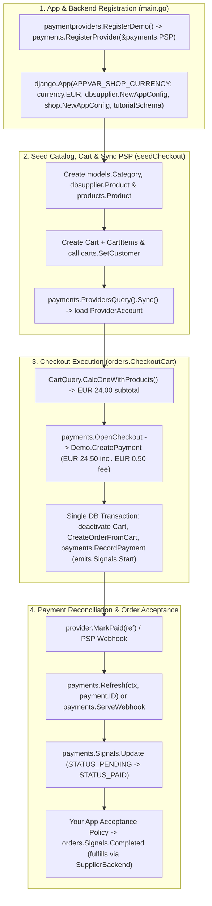

# Build a shop checkout with GO Django

Run a checkout with a database supplier and a simulated payment provider. Then use the same interfaces to connect your own catalogue, pricing, and payment accounts.

## Run the checkout

From the repository root, use the Go version in `go.work` and a C compiler for the SQLite driver. Run the tutorial with CGO enabled.

```sh
go run ./examples/commerce/tutorial
```

The program uses an in-memory database. It creates a category, a notebook, a cart with two notebooks and attached customer details, and syncs the tutorial payment provider account. The notebooks cost EUR 10.00 each. A 20% tax and a EUR 0.50 payment fee bring the checkout total to EUR 24.50.

```text
Prepared order <id> with payment <id> for EUR 24.50
Opened checkout in STATUS_PENDING at https://checkout.example.test/pay/<id>
Reconciled payment in STATUS_PAID. Order is order_pending.
```

Change the cart quantity in `seedCheckout` and run it again to see the recalculated amount. The simulation marks the payment as paid and leaves order acceptance to your application. [Runnable checkout](main.go)

## Setup and checkout walkthrough



## Install the shop in your application

Add `shop.NewAppConfig` to `django.Apps` with its dependencies. Set `shop.APPVAR_SHOP_CURRENCY` to the currency you use for cart pricing (a `currency.Unit`, an ISO currency code string, or a `func(context.Context) currency.Unit`), and configure a database and media backend. Create and apply migrations for your installed apps and supplier models before serving, and run the `sync-suppliers` and `sync-psp` management commands (or call `orders.SuppliersQuery().Sync()` and `payments.ProvidersQuery().Sync()`) to sync registered backends to the database. The tutorial creates its disposable schema during initialization. [App setup](main.go) · [Commerce application](../src/main.go)

## Add a category and a supplier

1. Create a `models.Category` for your products. Use `models.Categories().ChildrenOf(nil)` for the root catalogue categories or pass a parent to find its children.
2. Implement `products.ProductModel` (`ProductPrice(ctx context.Context) price.Money`) for the supplier-specific product. The database supplier embeds `*products.Product` and adds a `SupplierID` field. Register the concrete type in your app's models so its content type can be resolved when orders are loaded.
3. Implement `orders.SupplierBackend` and call `orders.RegisterSupplier` during app configuration. Use a stable `InternalName` as the value of `products.Product.Supplier`. The product admin calls the backend's `ProductType`, `ProductAddPanel`, and `ProductEditPanel`. Sync registered suppliers to `orders.SupplierModel` with `sync-suppliers` or `orders.SuppliersQuery().Sync()`.

Use `orders.Supplier` when callbacks are enough. For a dedicated backend, add a compile-time check like `var _ orders.SupplierBackend = (*MySupplier)(nil)`. Use `OrderBlock` to describe the fields stored in `OrderItem.SupplierData`. `OrderAccepted` is invoked automatically by the built-in `orders.Signals.Completed` fulfillment workflow. [Database supplier implementation](../src/suppliers/dbsupplier/app.go) · [Concrete product model](../src/suppliers/dbsupplier/models.go)

## Build the cart and apply coupons

Attach buyer details to an active cart with `carts.SetCustomer` (or `POST /api/carts/customer` in a storefront) for guest checkout, or let checkout fall back to an authenticated user's customer record. In a storefront request, use `carts.Query().WithContext(r.Context()).CartForRequest(r)` to find the active cart from the authenticated user or session. The public cart endpoints handle cart creation, customer details, and item changes. Use `CalcOne()` when you need the totals and `CalcOneWithProducts()` when you also need complete products for order snapshots. [Cart API](../../../contrib/shop/views/public/cart.go) · [Cart queries](../../../contrib/shop/carts/models_cart_query.go)

To try a coupon in a running storefront, create a `coupons.Coupon` in the admin, add an eligible product to the cart, and send `{"coupon_code":"WELCOME"}` to the URL for `api:coupons:redeem`. The response includes the recalculated cart wrapped in a `DataResponse` envelope. A coupon can target particular products through `CouponProductThrough`. Use `generators.GenerateCouponCode` to generate an available code for a new coupon. For example, a single static part can supply a recognizable code in a development database. [Coupon models](../../../contrib/shop/coupons) · [Redemption handler](../../../contrib/shop/views/public/coupons.go)

```go
code, err := generators.GenerateCouponCode(ctx, []generators.CodePart{
    {Type: generators.CPT_STATIC, Value: "WELCOME"},
})
```

Read `cart.Totals.Payable()` for the amount after cart discounts, including product fees and tax. Use `ProviderAccount.Quote` (backed by `price.QuoteFee`) for the payment account fee and currency rounding. The public payment options endpoint already combines these for the active cart. [Price calculation](../../../contrib/shop/shared/price/price.go) · [Payment options handler](../../../contrib/shop/views/public/payment_options.go)

## Register a payment provider

Implement `payments.Provider` in your application's payment provider package and register a `payments.ProviderBackend` (such as `&payments.PSP{...}`) with `payments.RegisterProvider`. Keep provider labels, currency (`currency.Unit`), customer fees, and credentials in Go code. Run `sync-psp` (or call `payments.ProvidersQuery().WithContext(ctx).Sync()`) to create or update the corresponding `payments.ProviderAccount` enable/disable rows in the database. [Runnable provider](paymentproviders/demo.go) · [Provider interface](../../../contrib/shop/payments/payments.go) · [Provider backends](../../../contrib/shop/payments/provider_backend.go)

| Method | Adapter responsibility |
| --- | --- |
| `CreatePayment` | Open checkout with the supplied `price.Money` amount and URLs. Use `AttemptID` as the provider idempotency key. |
| `GetPayment` | Look up a payment by provider reference and return its normalized state, amount, and currency. |
| `HandleWebhook` | Authenticate the provider's callback or verify the reported status with the provider before returning it. |

Implement `payments.Refunder` or `payments.Canceller` when your provider supports native refunds or cancellations. Keep the same `requestID` when retrying `payments.Refund` or `payments.Cancel`. [Payment service](../../../contrib/shop/payments/service.go)

Return `PaymentStatus.ProviderFee` (`*price.Money`) when the provider reports a processing fee charged to your merchant account. The shop records its amount and currency on the payment and shows it separately from the customer payment fee set by `ProviderAccount.Quote`. [Provider interface](../../../contrib/shop/payments/payments.go)

## Connect checkout to the storefront

For the built-in checkout, set `shop.APPVAR_SHOP_CHECKOUT_ORIGIN` to your public shop origin and optionally set `shop.APPVAR_SHOP_CHECKOUT_RETURN_PATH` to your order confirmation page. Attach guest customer details via `POST /api/carts/customer` (or sign in a user with a valid email address). Use `django.Reverse("api:payments:checkout")` as the action of a POST form, including the framework CSRF token and an `account_id` field with the ID from the payment options response (the view also accepts a JSON body). For a payable balance, checkout opens provider checkout first, then converts the cart into an order and payment record in one transaction and returns a `303 See Other` redirect to the provider. The return URL includes `payment_id` for looking up the payment. [Checkout handler](../../../contrib/shop/views/public/payment_checkout.go)

For a nonempty cart with a zero payable total, the payment options response contains one option with `no_payment_required: true`. Submit the form with an empty `account_id` or send `{}` as JSON. Checkout saves the order and a zero-value internal payment record, then redirects directly to your confirmation page with `order_id` and `payment_id`. A remaining balance from product fees still requires a payment account. [Payment options handler](../../../contrib/shop/views/public/payment_options.go)

For a custom checkout, call `orders.CheckoutCart` from your storefront handler:

1. Resolve the active cart (with `cart.Customer` attached, or an authenticated user on the request) and let the buyer select an eligible payment account when there is a payable balance.
2. Call `orders.CheckoutCart(r, orders.CheckoutOptions{...})`. For positive totals, `CheckoutCart` opens checkout with the PSP (`payments.OpenCheckout`) before touching the database, then atomically deactivates the cart, saves the `Order`, `OrderItem` pricing snapshots, applied coupon redemptions (`orders.Signals.Created`), and `Payment` (`payments.RecordPayment`, which emits `payments.Signals.Start`).
3. Check `result.Free`. A free checkout can go directly to your confirmation page; otherwise redirect the buyer to `result.Checkout.URL` when the provider supplies one. Build return and webhook URLs from your configured storefront origin, using `django.Reverse("api:payments:webhook", account.ID)` for the webhook path.
4. Use `payments.Refresh` or the registered webhook endpoint to reconcile payment status. Use that verified status in your application's acceptance policy.

`orders.CheckoutCart` takes its default amount from `cart.Totals.Payable()`. To include a EUR 4.00 shipping charge in this example, set `Pricer` on `orders.CheckoutOptions`: [Checkout source](../../../contrib/shop/orders/checkout.go)

```go
opts.Pricer = func(_ context.Context, cart *carts.CartRow) (price.Money, error) {
    return price.Money{
        Amount:   cart.Totals.Payable().Add(decimal.NewFromInt(4)),
        Currency: currency.EUR,
    }, nil
}
```

## Customize the shop admin

Use the supplier's panels to add product fields. Use the shop's admin registrations in `contrib/shop/adminsite` and views in `contrib/shop/views/adminviews` for the existing product and order workflows. For a custom list, start with `generic.ListViewConfig` and pass your model, queryset, filters, and columns. For a custom edit form, `util/forms.NewAdminForm` binds a model and its panels to a request. [Admin registrations](../../../contrib/shop/adminsite) · [Product and order views](../../../contrib/shop/views/adminviews) · [List configuration](../../../contrib/shop/views/adminviews/generic/listview.go) · [Form helper](../../../contrib/shop/util/forms/forms.go)

## Extend the order lifecycle

The order editor counts coupon uses when an order is marked complete and releases outstanding reservations when it is rejected. If your own workflow saves either transition, call `orders.ReconcileCouponRedemptions` with the saved order ID in the same transaction.

Keep order checkout, state transitions, and supplier capabilities in `orders`, and keep provider adapters and payment reconciliation in `payments`. Use `shared/relations/modelkeys` with deferred relations when two model packages need to refer to each other. [Deferred payment to order relation](../../../contrib/shop/payments/models_payment.go)

When adding acceptance and fulfillment, let the application decide when to accept a verified payment. Account for both `payments.Signals.Start` and `payments.Signals.Update` (the initial provider response can already be paid, and later updates can come from a webhook or refresh). Once your acceptance policy is satisfied, send `orders.Signals.Completed` — the built-in listener in `orders/supplier_workflow.go` locks the order, invokes each line's `SupplierBackend.OrderAccepted` and validates returned data against `OrderBlock`, transitions the order to `orders.OrderStateAccepted` (`Completed = true`, `Processed = true`), reconciles coupon redemptions, and emits `orders.Signals.Accepted` and `orders.Signals.Processed`. [Supplier workflow](../../../contrib/shop/orders/supplier_workflow.go)

Run the shop integration suite after changing a workflow or an adapter.

```sh
go test -tags "testing_auth test sqlite" ./contrib/shop/... ./examples/commerce/...
```

## Package map

| Shop package | Where to use it |
| --- | --- |
| [`shop`](../../../contrib/shop) | Install the app, configure currency, register stock routes/models, and run `sync-psp` / `sync-suppliers`. |
| [`adminsite`](../../../contrib/shop/adminsite) | Reuse or inspect the stock `admin.ModelOptions` definitions for shop models. |
| [`carts`](../../../contrib/shop/carts) | Resolve active carts, attach guest customer details, and calculate totals with products and redemptions. |
| [`coupons`](../../../contrib/shop/coupons) | Define discount rules, product targets, and redemptions. |
| [`coupons/generators`](../../../contrib/shop/coupons/generators) | Generate coupon codes and render the coupon generator widget. |
| [`customers`](../../../contrib/shop/customers) | Store the customer record associated with a cart or order. |
| [`handlers`](../../../contrib/shop/handlers) | Follow the built-in shop signal listeners (products, carts, coupons, orders, and payments) for audit logging. |
| [`models`](../../../contrib/shop/models) | Build the category tree and query its children. |
| [`orders`](../../../contrib/shop/orders) | Orchestrate checkout (`CheckoutCart`), create orders and line snapshots, register suppliers, and run the fulfillment workflow. |
| [`payments`](../../../contrib/shop/payments) | Register code-first PSP backends (`PSP` / `ProviderBackend`), sync accounts, open checkout, reconcile status, and issue refunds/cancellations. |
| [`products`](../../../contrib/shop/products) | Define the common product record and the interface for concrete supplier products. |
| [`shared/api`](../../../contrib/shop/shared/api) | Read JSON and write `DataResponse` / `ErrorResponse` envelopes in custom shop HTTP handlers. |
| [`shared/price`](../../../contrib/shop/shared/price) | Represent `Money` / `Quote` with `currency.Unit` and calculate line totals, discounts, fees, and taxes. |
| [`shared/relations/modelkeys`](../../../contrib/shop/shared/relations/modelkeys) | Reference model types through deferred relations across packages. |
| [`shared/signals`](../../../contrib/shop/shared/signals) | Use the shop's typed signal pool and shared request or change payloads. |
| [`util/forms`](../../../contrib/shop/util/forms) | Build a shop admin form from a model and its panels. |
| [`util/paystate`](../../../contrib/shop/util/paystate) | Use the normalized payment states shared by provider adapters and the admin. |
| [`views/adminviews`](../../../contrib/shop/views/adminviews) | See how the stock admin handles supplier selection, order editing, and coupon generation. |
| [`views/adminviews/generic`](../../../contrib/shop/views/adminviews/generic) | Reuse list view configuration, filters, and pagination controls. |
| [`views/public`](../../../contrib/shop/views/public) | Use the cart, customer, coupon redemption, payment options, and checkout HTTP handlers. |
