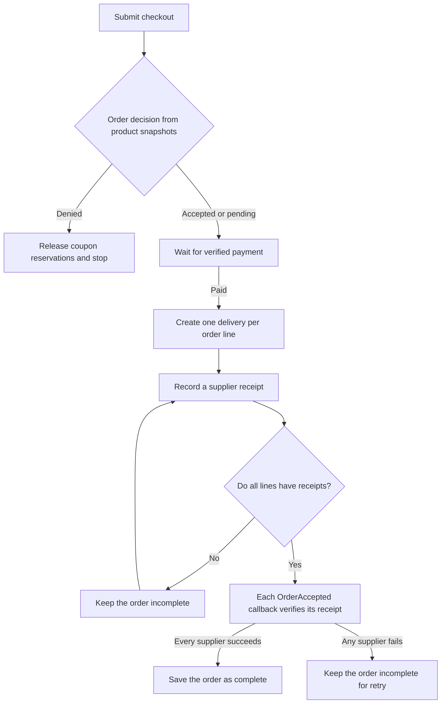

# Build a shop checkout with Go-Django

This tutorial is a small Go-Django app with a checkout form, an order page, and two simulated suppliers. It uses the shop's checkout, payments, and supplier workflow. The app supplies its own order policy and delivery confirmations.

## Run the app

Use the Go version in `go.work` and a C compiler with CGO enabled for SQLite. Run the tutorial from the repository root.

```sh
go run ./examples/commerce/tutorial
```

The app seeds its catalog and creates an in-memory database at startup. Use `-port 8082` to listen on a different port. [Open the storefront](http://127.0.0.1:8081)

## Try each order decision

Enter an email address, select a notebook, and submit the checkout form. Every cart has two EUR 10.00 notebooks from one supplier and one EUR 5.00 pen from another. The 20% tax and EUR 0.50 payment fee bring the total to EUR 30.50.

| Notebook | Order decision | What you can do |
| --- | --- | --- |
| In stock | Accepted | Simulate payment. |
| Backorder | Pending | Simulate payment. |
| Discontinued | Denied | View the order and return to checkout. |

Follow payment and delivery on the accepted or pending order page.

1. Check that **Payment** is `STATUS_PENDING` and **Completed** is **No**.
2. Select **Simulate payment**. The order page now shows one delivery to confirm for each supplier.
3. Select **Confirm delivery** on either line. Its receipt appears and **Completed** stays **No**.
4. Confirm the other delivery. The order shows **Accepted** with **Completed** set to **Yes**.

Try the discontinued notebook in a fresh checkout. The denied order stops at the order page, where you can return to checkout. `CheckoutCart` opens the provider session before saving the order, so the denied order can have an unpaid payment record.

## Build the same flow

1. **Configure the app.** Register Go-Django and the shop dependencies in `main.go`. The store app registers its models, routes, templates, and signal listeners. The seed code creates the demo tables and catalog and syncs two suppliers and a payment provider. [Entry point](main.go) · [App configuration](store/app.go) · [Seed data](store/seed.go)
2. **Model the app's data.** `Product` extends the shop product with availability. `Delivery` belongs to one order line and stores its confirmation receipt. Checkout, order lines, and payments use the shop's models. [Store models](store/models.go)
3. **Create the order in a view.** `POST /checkout` builds a cart and passes it to `orders.CheckoutCart`. The `orders.Signals.Created` listener reads availability from the product snapshots and saves the decision in the checkout transaction. Denial also releases any coupon reservations. [Checkout and order views](store/views.go) · [Order signal handler](store/signals.go) · [Coupon reconciliation](../../../contrib/shop/docs/coupons.md#order-conversion--redemption-reconciliation)
4. **Create deliveries from confirmed payment.** `POST /orders/<id>/pay` calls `MarkPaid` on the simulated provider and `payments.Refresh` to reconcile the result. The app handles both `payments.Signals.Start` for a payment already confirmed at checkout and `payments.Signals.Update` for later confirmation. The listeners create one `Delivery` per line in the payment transaction for eligible orders. A zero-total checkout uses the same delivery setup directly from the checkout result. [Demo provider](paymentproviders/demo.go) · [Payment signals](store/signals.go) · [Checkout and payment APIs](../../../contrib/shop/docs/payments-and-checkout.md)
5. **Confirm deliveries and finish the order.** `POST /orders/<id>/deliveries/<delivery>/confirm` records the receipt for one line and sends the app's `DeliveryConfirmed` signal. Its handler waits for all line receipts, then sends `orders.Signals.Completed` to start the shop's supplier workflow. Each supplier's `OrderAccepted` callback reads its line's receipt and returns success when delivery is confirmed. The shop saves `Order.Completed` only after every supplier callback succeeds. [Delivery signals](store/signals.go) · [Supplier backends](store/suppliers.go) · [Shop order lifecycle](../../../contrib/shop/docs/signals-and-order-flow.md#delivery-and-completion)

The checkout page and `GET /orders/<id>` render plain HTML templates. Each action is a POST form with a CSRF token. Follow an order in the same browser session that placed it. [Checkout template](store/templates/store/checkout.tmpl) · [Order template](store/templates/store/order.tmpl)



## Connect real providers and suppliers

Have your payment adapter verify provider status before the payment listeners act on it. Feed supplier confirmations from your delivery integration into the application, and use migrations for the catalog and delivery tables. [Payment provider setup](../../../contrib/shop/docs/payments-and-checkout.md#code-first-provider-backend-registry--sync) · [Supplier setup](../../../contrib/shop/docs/suppliers.md) · [Full shop example](../src/main.go)

Run the shop integration tests after changing signal handlers or adapters.

```sh
go test -tags "testing_auth test sqlite" ./contrib/shop/... ./examples/commerce/...
```
